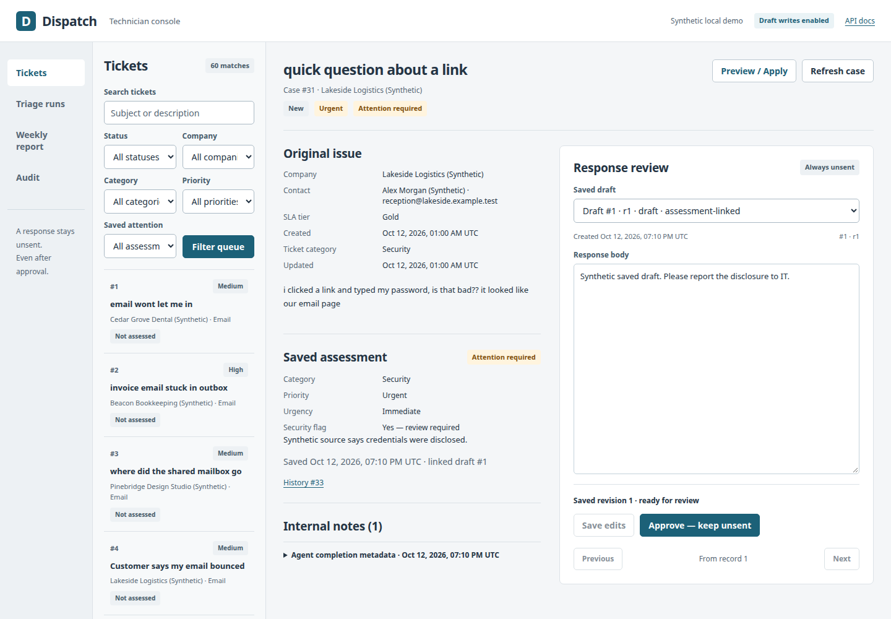

# Dispatch

**An AI-assisted IT helpdesk with a human review workbench.**

Dispatch gathers ticket and company context through MCP, finds relevant historical resolutions,
classifies the issue, and drafts a response. A technician inspects the assessment, edits the saved
draft, and approves the exact reviewed revision. **Approval never sends a message.**

This is a **local portfolio demo using synthetic NorthPoint IT scenarios**—not a production PSA. No
authentication, real client data, public deployment, or sending.



_The working console with synthetic test data._

## What you can do

- **Review tickets:** filter the queue and inspect source text, company/contact/SLA context, saved
  assessments, attention flags, and unsent drafts side by side.
- **Run triage:** Preview the real model/MCP workflow, or explicitly Apply to save classification,
  an unsent draft, and the linked assessment.
- **Edit and approve safely:** revision checks reject stale edits/approvals; conflicts preserve
  local text. Partial or uncertain writes are visible, never automatically retried.
- **Inspect operations:** monitor background runs, view UTC weekly reports, and read backend/MCP
  audit metadata separately.
- **Evaluate models:** run 40 labeled synthetic cases with deterministic classification scoring and
  optional, separately configured LLM-as-a-judge draft metrics.

## Run the demo

Requires **Python 3.12 and Poetry 2.x**. Run commands from the repository root. The UI is served by
FastAPI; no Node build step or separate frontend server is needed.

### 1. Install

```bash
poetry env use python3.12
poetry install
test -f .env || cp .env.example .env
```

**New, empty database only:** load the 60 synthetic tickets:

```bash
poetry run python -m dispatch.mock_psa.seed
```

Already have a demo database? **Keep it—do not reset or reseed.** If startup requests an upgrade,
follow the [migration instructions](docs/API.md#upgrading-an-existing-database). The default
database is `data/dispatch.db`; `.env` controls the configured path.

### 2. Configure a model when you want generation

Browsing tickets, reports, and audits needs no LLM. For generation, configure an OpenAI-compatible
Chat Completions endpoint in `.env`. Example for an already-running local Ollama service with
`qwen3.5:4b` installed:

```dotenv
OPENAI_BASE_URL=http://127.0.0.1:11434/v1
OPENAI_MODEL=qwen3.5:4b
OPENAI_API_KEY=
OPENAI_OUTPUT_MODE=json_schema
OPENAI_REASONING_EFFORT=none
OPENAI_TIMEOUT_SECONDS=300
```

Use your actual installed model tag and supported output/reasoning settings. Dispatch neither hosts
nor silently chooses a model. See
[model configuration](docs/TRIAGE.md#install-and-configure-your-chosen-model) for other providers.
Keep credentials out of Git.

### 3. Open the workbench

Stop any older Dispatch API first. Start one worker with draft writes explicitly enabled:

```bash
DISPATCH_READ_ONLY=false poetry run uvicorn dispatch.mock_psa.main:app \
  --host 127.0.0.1 --port 8000 --workers 1
```

Open **http://127.0.0.1:8000/console/**. For read-only inspection, use `DISPATCH_READ_ONLY=true`
instead. Restart the API after changing model/write settings.

In **Triage runs**, start Preview, inspect the result, then deliberately run Apply when you want
persisted assessments and drafts. Apply regenerates—it does not save the exact text of an earlier
preview. Open the resulting ticket to review its saved draft.

**“Not assessed” means no valid saved assessment.** Preview and offline evaluation can run
successfully without changing that label.

## Run the demo queue from the terminal

With the write-enabled API and configured model running:

```bash
OPENAI_OUTPUT_MODE=json_schema DISPATCH_READ_ONLY=false \
poetry run python -m dispatch.agent.cli \
  --apply --limit 20 --base-url http://127.0.0.1:8000
```

Processes up to **20 untriaged new tickets**. To process the whole eligible queue in one command:

```bash
OPENAI_OUTPUT_MODE=json_schema DISPATCH_READ_ONLY=false \
poetry run python -m dispatch.agent.cli \
  --apply --all --base-url http://127.0.0.1:8000
```

`--all` reads the paginated new-ticket queue at startup and processes it one ticket at a time until
finished or a failure occurs. Completed tickets are skipped. In-progress, resolved, and closed tickets are not re-triaged.
The fresh seed has 24 new tickets. Newly arriving tickets wait for the next command.

Both modes stop on failed/partial/uncertain results; inspect the printed report and saved records
before retrying. Do not run CLI and UI triage concurrently. Refresh the workbench to see saved flags
and drafts.
[Batch limits, preview, recovery, and run-history details](docs/TRIAGE.md).

## Live triage vs. offline evaluation

| Workflow           | Context                                      | Updates dashboard ticket data?                  |
| ------------------ | -------------------------------------------- | ----------------------------------------------- |
| Live Preview       | PSA + MCP + historical retrieval + model     | No; backend jobs/audit metadata may be saved    |
| Live Apply         | Same workflow, with explicit guarded writes  | Yes: labels, assessment/attention, unsent draft |
| Offline evaluation | Frozen labeled cases + model; optional judge | No PSA access or mutations                      |

To generate and score **all 40 evaluation cases**, without a judge:

```bash
OPENAI_OUTPUT_MODE=json_schema \
poetry run python -m dispatch.evaluation.cli --no-judge
```

These schema-mode commands suit the tested Ollama setup; use your provider's supported mode. Human
review remains essential: pipeline completion is not a model-quality or security guarantee. There is
no automatic approval, remediation, ticket closing, or sending.

## Documentation

- [Live triage and model configuration](docs/TRIAGE.md)
- [Technician console and operational checks](docs/CONSOLE.md)
- [Offline evaluations and judge setup](docs/EVALUATION.md)
- [Database migration and REST contracts](docs/API.md) · running API: `/docs`
- [MCP integration, similarity, and reporting](docs/MCP.md)
- [Development, tests, and editable examples](docs/DEVELOPMENT.md)
- [Engineering decisions and development history](DECISIONS.md)
